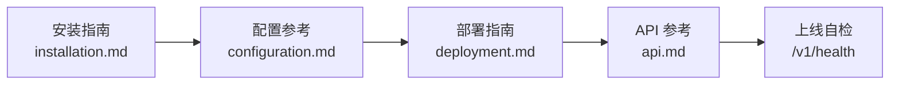
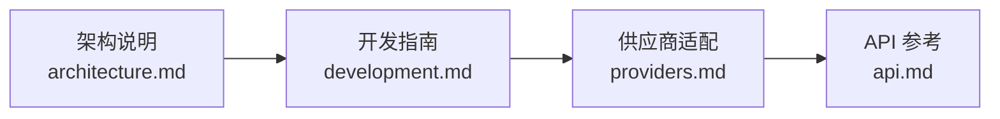
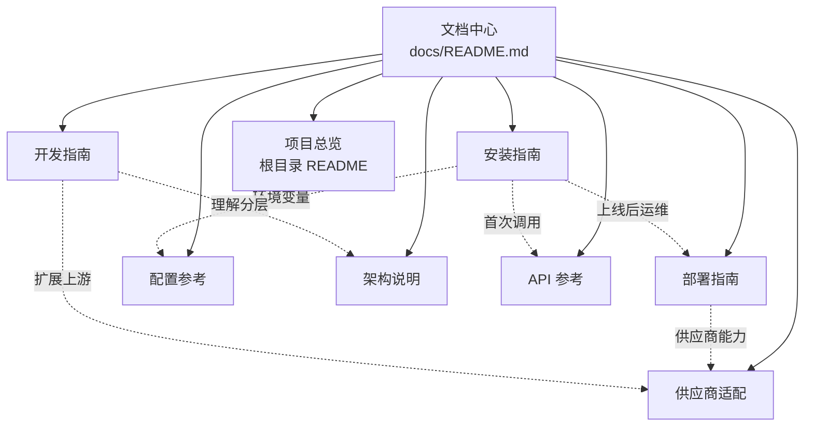
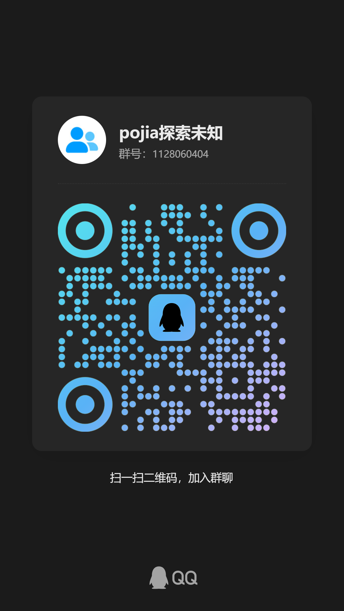

# 文档中心

  
  
  
  

这里是 **AI 聚合网关（AIGW）后端**的完整文档中心。项目把多个 AI 上游账号池聚合成一个
**OpenAI 兼容网关**，并附带管理后台与用户控制台。

> [!TIP]
> 第一次接触本项目，请按 **总览 → 安装 → 配置 → 部署** 的顺序阅读；只需要对接接口的话，
> 直接跳到 [API 参考](api.md) 即可。

---

## 1. 文档一览

| 文档 | 内容 | 适合谁 |
| --- | :-: | :-: |
| [安装指南](installation.md) | 从零部署：环境检查、建库、`.env`、安装脚本、Web 服务器、首次配置、本地开发环境 | 首次部署者 |
| [部署指南](deployment.md) | 生产运维：Nginx / Apache / PHP-FPM、计划任务、CDN 回源令牌、备份升级、排障、安全加固 | 运维 / 站长 |
| [配置参考](configuration.md) | 全部环境变量与默认值、会话与 PHP 参数 | 所有人 |
| [架构说明](architecture.md) | 请求生命周期、分层职责、数据模型（29 张表）、核心链路 | 二次开发者 |
| [API 参考](api.md) | OpenAI 兼容接口、用户端 / 管理端接口、错误格式 | 客户端 / 对接方 |
| [供应商适配](providers.md) | 13 个内置上游、登录方式、能力矩阵、凭据存储、新增供应商 | 扩展开发者 |
| [开发指南](development.md) | 代码约定、新增接口 / 服务的完整示例、调试、数据库变更、提交规范 | 二次开发者 |
| [发布说明](../CHANGELOG.md) | 版本功能、变更记录与已知限制 | 所有人 |
| [隐私说明](../PRIVACY.md) | 实例处理的数据、用途、保留期与用户权利 | 运维 / 合规 |
| [第三方声明](../THIRD-PARTY-NOTICES.md) | 第三方组件、商标素材、AGPL 授权范围 | 所有人 |
| [许可证](../LICENSE) | GNU AGPL-3.0 全文 | 所有人 |
| [项目总览](../README.md) | 功能特性、技术栈、目录结构、快速开始 | 所有人 |

---

## 2. 三条推荐阅读路径

### 路径 A · 我要部署上线

1. [安装指南](installation.md) —— 跟着清单一步步做完
2. [配置参考](configuration.md) —— 核对每个环境变量
3. [部署指南](deployment.md) —— Nginx、计划任务、CDN、备份
4. [API 参考](api.md) —— 用 `curl` 跑通第一次对话

### 路径 B · 我要二次开发

1. [架构说明](architecture.md) —— 先弄清楚请求怎么流动
2. [开发指南](development.md) —— 照抄新增接口的模板
3. [供应商适配](providers.md) —— 接入新的上游
4. [API 参考](api.md) —— 确认对外契约不被破坏

### 路径 C · 我只想调用网关

1. [API 参考](api.md) —— 认证方式与请求/响应格式
2. [安装指南 § 11](installation.md#11-首次登录与初始化检查清单) —— 如何生成 API Key
3. [配置参考](configuration.md#3-网关) —— 网关地址与限流相关配置

---

## 3. 文档地图

---

## 4. 快速跳转

| 我想…… | 去哪里 |
| --- | --- |
| 在这台机器上装起来 | [安装指南](installation.md#1-开始之前) |
| 知道每个环境变量干什么 | [配置参考](configuration.md) |
| 配 Nginx / PHP-FPM / cron | [部署指南](deployment.md) |
| 让 CDN 后面的真实 IP 正确 | [部署指南 § 6](deployment.md#6-cdn-场景腾讯云-edgeone) |
| 生成或重置管理员账号 | [安装指南 § 6](installation.md#6-执行安装脚本) |
| 用 OpenAI SDK 调网关 | [API 参考 § 2](api.md#2-openai-兼容接口) |
| 新增一个上游供应商 | [供应商适配 § 6](providers.md#6-新增供应商) |
| 新增一个接口 | [开发指南 § 5](development.md#5-新增一个接口的完整示例) |
| 查报错原因 | [部署指南 § 10](deployment.md#10-故障排查) · [安装指南 § 13](installation.md#13-常见安装问题) |

---

## 5. 反馈与交流

文档有误、缺少章节、想提需求或跟踪更新，欢迎加入反馈群。

| 方式 | 信息 |
| --- | --- |
| 群名称 | **pojia探索未知** |
| QQ 群号 | **1128060404** |
| 加群 | 手机 QQ 扫码，或在 QQ 里搜索群号 |

  

也可见 [项目总览的反馈区](../README.md#反馈与交流)。

## 6. 法律与合规

| 文档 | 一句话要点 |
| --- | --- |
| [发布说明](../CHANGELOG.md) | 1.0.0 首个公开版本的功能、变更与已知限制 |
| [隐私说明](../PRIVACY.md) | 软件无遥测；部署者即数据控制者；对话内容可能按配置落库 |
| [第三方声明](../THIRD-PARTY-NOTICES.md) | 仅 Vue 3（MIT）为第三方代码；供应商 Logo 为商标素材 |
| [许可证（AGPL-3.0）](../LICENSE) | 原创代码按 AGPL-3.0 授权；公网提供服务需提供源码 |

> AGPL-3.0 的**网络使用条款（§13）**规定：修改本软件后通过公网提供交互式服务，
> 必须向用户提供获取完整源码的方式。部署前请确认你可以接受该义务。

## 7. 文档约定

- 所有文档使用**简体中文**，相对链接（例如 `installation.md`）在 GitHub 上可直接点击跳转。
- 每个文档顶部都有统一导航，保证「打开任何一页都能跳到其它任何一页」。
- 截图与路径统一以 `/www/wwwroot/aigw` 为例；本地开发示例以 Windows + phpStudy 为例。
- 命令中的 `php` 在生产环境应替换为**绝对路径**（如 `/www/server/php/82/bin/php`）。
- 仓库**不包含**测试脚本、探针工具、客户端 App、数据库导出与任何真实账号口令，详见
  [开发指南 § 11](development.md#11-仓库不包含的内容)。
