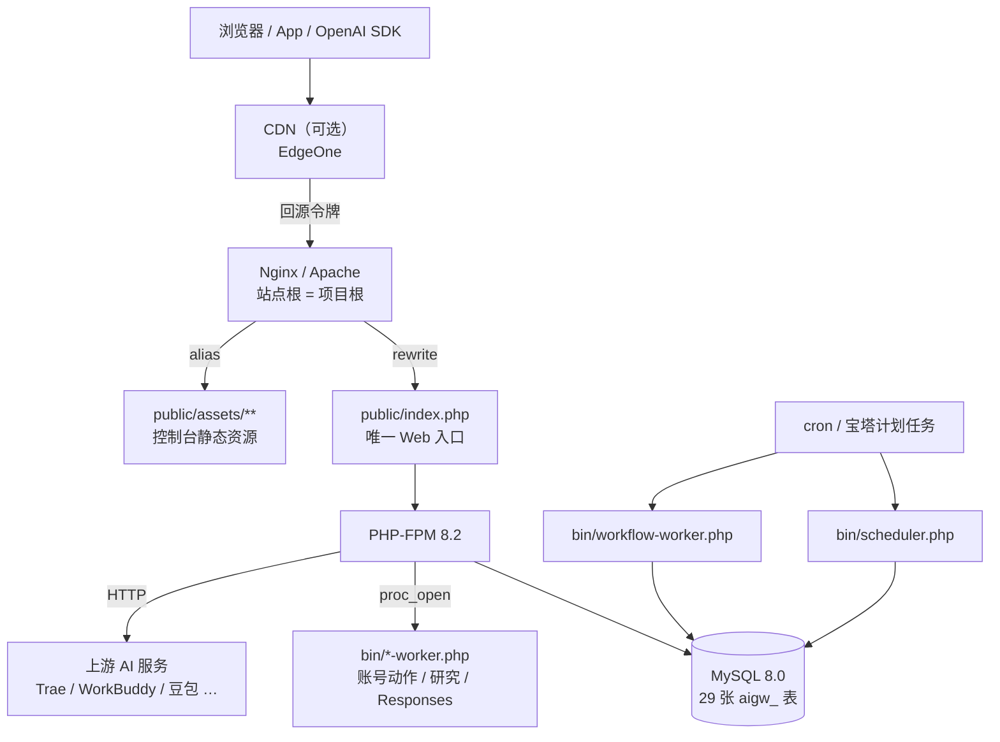
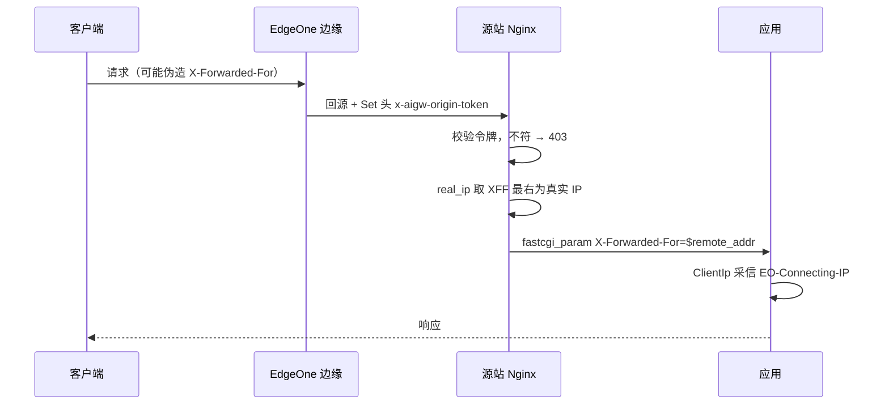

# 部署指南

> **文档导航**：[总目录](README.md) · [安装](installation.md) · [部署](deployment.md) · [配置](configuration.md) · [架构](architecture.md) · [API](api.md) · [供应商](providers.md) · [开发](development.md)

本文面向**生产环境运维**：服务器拓扑、Nginx / Apache / PHP-FPM、计划任务、CDN 回源、
备份升级、监控与故障排查。首次安装请先完成 [安装指南](installation.md)，再回到这里。

---

## 目录

- [1. 部署拓扑](#1-部署拓扑)
- [2. 环境要求](#2-环境要求)
- [3. 上传与目录权限](#3-上传与目录权限)
- [4. 安装与初始化](#4-安装与初始化)
- [5. Web 服务器](#5-web-服务器)
- [6. CDN 场景（腾讯云 EdgeOne）](#6-cdn-场景腾讯云-edgeone)
- [7. 计划任务](#7-计划任务)
- [8. 升级与回滚](#8-升级与回滚)
- [9. 安全加固清单](#9-安全加固清单)
- [10. 故障排查](#10-故障排查)
- [11. 备份与监控](#11-备份与监控)

---

## 1. 部署拓扑



关键点：

- **无常驻进程**。所有「后台能力」都由 cron 或 Web 请求里的 `proc_open` 触发，运维上只需保证 cron 在跑。
- **单入口**。除静态资源外，所有请求都进 `public/index.php`，安全策略只需守好这一个点。
- **站点根是项目根**，不是 `public/`。这是本项目最容易配错的地方。

---

## 2. 环境要求

| 组件 | 要求 | 检查命令 |
| --- | --- | --- |
| PHP | 8.2+（CLI 与 FPM 必须是同一版本） | `php -v` / `php -i \| grep disable_functions` |
| MySQL | 8.0+，`utf8mb4` | `mysql -V` |
| Nginx | 1.20+，建议带 `http_realip_module` | `nginx -V` |
| Apache | 2.4+，开启 `mod_rewrite` | `apache2ctl -M \| grep rewrite` |
| 扩展 | `pdo_mysql`、`openssl`、`curl`、`mbstring`、`json`、`session`、`gd` | `php -m` |
| 可选 | Node ≥ 20.10 + Chrome（验证码求解）、`proc_open` 可用（异步任务） | `node -v`、`php -r 'var_dump(function_exists("proc_open"));'` |

详见 [安装指南 § 2](installation.md#2-环境检查)。

---

## 3. 上传与目录权限

```bash
# 站点目录建议：/www/wwwroot/aigw
cd /www/wwwroot/aigw
chown -R www:www .
find storage -type d -exec chmod 775 {} \;
chmod -R 775 storage
chmod 600 .env
```

`storage/` 下会自动创建：

| 路径 | 内容 |
| --- | --- |
| `storage/sessions/` | 会话文件 |
| `storage/logs/` | `app-YYYY-MM-DD.log`、`php-error.log`、worker 日志、`cron.log` |
| `storage/tmp/` | 临时文件 |
| `storage/backup/`、`storage/login/`、`storage/persona/` | 业务缓存 |

> [!WARNING]
> 关闭宝塔的「防跨站攻击（open_basedir）」。它会让 `.env` 不可读、`storage/` 不可写、
> `proc_open` 子进程无法启动，典型症状是「登录后刷新掉线」或「整站 500」。

---

## 4. 安装与初始化

```bash
cp .env.example .env
vi .env      # 填 AIGW_APP_URL、AIGW_DB_*、AIGW_APP_KEY

AIGW_INSTALL_ADMIN_PASSWORD='强口令' php database/install.php
```

期望输出：

```text
[✓] 数据库连接成功 (127.0.0.1:3306)
[✓] 数据库就绪：aigw
[✓] 表结构创建完成（共 N 条语句）
[✓] 管理员账号：admin / **********（请登录后立即修改）
[✓] 网关 API Key：sk-aigw-********
```

> [!CAUTION]
> `schema.sql` 每张表前都有 `DROP TABLE IF EXISTS`，因此 **`--force` = 清空整库**。
> 库中已有业务数据时必须额外设置 `AIGW_ALLOW_DESTRUCTIVE=1` 才会执行。
> 升级场景**永远不要**用 `--force`。

完整的变量含义、安装步骤与本地环境见 [安装指南](installation.md) 与 [配置参考](configuration.md)。

---

## 5. Web 服务器

### 5.1 Nginx（推荐）

用 [deploy/nginx-aigw.conf](../deploy/nginx-aigw.conf) 整体替换站点配置。需要确认的三处：

| 配置项 | 默认值 | 说明 |
| --- | --- | --- |
| `server_name` | `example.com` | 改成你的域名 |
| `root` / `alias` | `/www/wwwroot/aigw` | 改成实际站点路径 |
| `fastcgi_pass` | `unix:/tmp/php-cgi-82.sock` | `ls -l /tmp/php-cgi-8*.sock` 查实际值 |

配置要点：

- 站点「网站目录」保持为**项目根目录**，不要指到 `public/`
- 入口 rewrite 到 `public/index.php`
- `/assets/*` 用 `alias` 指向 `public/assets`
- 关闭 `open_basedir`
- **SSE 必须单独一个 `location`**，并关闭所有缓冲：

```nginx
location = /v1/chat/completions {
    fastcgi_pass unix:/tmp/php-cgi-82.sock;
    fastcgi_param SCRIPT_FILENAME $document_root/public/index.php;
    fastcgi_buffering off;
    fastcgi_keep_conn on;
    gzip off;
    chunked_transfer_encoding on;
    fastcgi_read_timeout 360s;   # 与 PHP 侧 300s 对齐并留余量
}
```

- 敏感路径必须封禁（日志里含用户 prompt 原文、`.env` 含数据库口令与主密钥）：

```nginx
location ~ ^/(storage|database|docs|tools|tests|app|config|routes|bin)(/|$) { return 404; }
location ~* \.(env|sql|log|bak|md|ini|sh|bat|ps1|lock|yml|yaml|htaccess)$ { return 404; }
location ~ /\.(?!well-known) { return 404; }
```

改完执行：

```bash
nginx -t && nginx -s reload
```

### 5.2 Apache

站点根指向项目根，仓库根目录的 `.htaccess` 已提供等价规则：

```apache
RewriteRule ^assets/(.*)$ public/assets/$1 [L]
RewriteRule ^$ public/index.php [L]
RewriteCond %{REQUEST_FILENAME} !-f
RewriteCond %{REQUEST_FILENAME} !-d
RewriteRule ^ public/index.php [L]
```

需要 `AllowOverride All` 且启用 `mod_rewrite`。

### 5.3 PHP-FPM / php.ini

参考 [deploy/php-fpm-snippet.conf](../deploy/php-fpm-snippet.conf) 与
[deploy/php-ini-snippet.ini](../deploy/php-ini-snippet.ini)：

```ini
session.save_path = "/www/wwwroot/aigw/storage/sessions"
session.gc_maxlifetime = 604800
output_buffering = Off
zlib.output_compression = Off
max_execution_time = 300
memory_limit = 512M
```

> [!IMPORTANT]
> 开启了 `open_basedir` 时，上述 `session.save_path` 会被拒绝写入，
> 表现为「登录后立刻掉线」「500」。这类问题在日志里通常只有一行
> `session_start(): open(...) failed: Permission denied`。

---

## 6. CDN 场景（腾讯云 EdgeOne）

EdgeOne 的回源 IP 段接口已下线，无法用 `set_real_ip_from` 还原客户端 IP。本项目采用**回源令牌**：



部署三步，**缺一步都不成立**：

1. **EO 控制台**
   - 「站点加速 → 回源配置 → 真实客户端 IP 回源」**开启**
   - 「规则引擎 → 修改 HTTP 回源请求头」新增 `x-aigw-origin-token`，操作类型必须选
     **「设置 / Set」**，不能选「添加 / Add」
   - 口令用 `openssl rand -hex 32` 生成（纯 hex，不会破坏 nginx 语法）
2. **Nginx**：在站点 `server` 块内启用模板（`deploy/nginx-aigw.conf` 中「⓪ 真实客户端 IP」段）
3. **应用层 `.env`**

```dotenv
AIGW_ORIGIN_TOKEN=与 CDN 控制台一致的口令
AIGW_ORIGIN_TOKEN_HEADER=x-aigw-origin-token
AIGW_CLIENT_IP_HEADER=eo-connecting-ip
AIGW_TRUSTED_PROXIES=
```

> [!CAUTION]
> 若 CDN 侧误用「添加 / Add」，攻击者自带的同名头会被追加成
> `"伪造值, 真值"`，精确匹配失败 → **全站 403**。这是 fail-closed（立刻可见），
> 改回「设置 / Set」即可恢复。
>
> 另外 `real_ip_recursive` **必须为 `off`**：EO 把真实 IP 追加在 XFF **最右**，
> `on` 会一路剥到最左（客户端伪造的值），防护彻底失效。

验证（必须走真实 HTTP，CLI 测不出这条链路）：

```bash
# ① 不带口令直连源站 → 期望 403
curl -sI http://<源站IP>/api/site-config

# ② 带对口令直连 → 期望 200
curl -sI -H "x-aigw-origin-token: <口令>" http://<源站IP>/api/site-config

# ③ 走域名 → 应返回你自己的公网 IP
curl -s https://<域名>/api/client-ip
```

> [!NOTE]
> 判据不是「配完了没有」，而是 ③ 返回的是不是**你自己的公网 IP**。
> 返回 `127.0.0.1`、内网或机房地址，说明链路没通，此时全站用户会挤进同一个限流桶，
> 表现是「真实用户被误伤 429」。

---

## 7. 计划任务

本项目无常驻进程，依赖 cron 周期触发：

```cron
# 内置调度：自动签到 / Token 保活 / 积分巡检（幂等，建议 5 分钟）
*/5 * * * * cd /www/wwwroot/aigw && /www/server/php/82/bin/php bin/scheduler.php >> /www/wwwroot/aigw/storage/logs/cron.log 2>&1

# 用户工作流调度（建议 1 分钟）
* * * * * cd /www/wwwroot/aigw && /www/server/php/82/bin/php bin/workflow-worker.php >> /www/wwwroot/aigw/storage/logs/cron.log 2>&1
```

说明：

- 必须写 **PHP 绝对路径**（宝塔定时任务的 PATH 与登录 shell 不同，容易误用系统自带的 PHP 5.4）
- `scheduler.php` 幂等，但**没有并发锁**：触发间隔必须大于单次执行耗时
- 各任务总开关默认关闭，需在管理台「设置」中打开
- 若使用 ZCode 领额度能力，计划任务环境需能访问 Node：`AIGW_NODE_BIN=/usr/bin/node`
- 时区必须为 `Asia/Shanghai`（cron 用系统时区，脚本内判定用 PHP 时区）

其他 worker 由 Web 端自动拉起，cron 仅作兜底：

| 脚本 | 用途 | 日志 |
| --- | --- | --- |
| `bin/action-worker.php <task_id>` | 账号动作异步执行（如领额度） | `storage/logs/action-worker.log` |
| `bin/research-worker.php <task_id>` / `--due` | 深度研究任务 | `storage/logs/research-worker.log` |
| `bin/responses-worker.php <response_id>` / `--due` | 后台 Responses | `storage/logs/responses-worker.log` |
| `bin/scheduler.php` | 内置签到 / 保活 / 巡检 | `storage/logs/app-*.log` |
| `bin/workflow-worker.php` | 用户自定义工作流按图执行 | `storage/logs/workflow-worker.log` |

更细的宝塔配置与 CentOS 7 注意事项见 [deploy/crontab.txt](../deploy/crontab.txt)。

---

## 8. 升级与回滚

### 8.1 升级前

```bash
# 数据库
mysqldump -u<user> -p <db> > backup-$(date +%F-%H%M).sql

# 代码与运行数据
tar -czf aigw-backup-$(date +%F).tar.gz .env storage
```

### 8.2 升级

```bash
git pull                              # 或解压新版本覆盖
php database/install.php              # 已有表会跳过建表，不会清空数据
chown -R www:www storage
nginx -s reload
```

需要新增表/字段时，单独执行**增量 SQL**，**不要**带 `--force`。

### 8.3 回滚

```bash
git checkout <上一个可用 tag/commit>
mysql -u<user> -p <db> < backup-YYYY-MM-DD.sql
```

> [!WARNING]
> 若新版本改动了表结构，仅回滚代码会因字段缺失/多余而报错，必须同时回滚数据库。
> 若 `.env` 的 `AIGW_APP_KEY` 被改过，凭据将无法解密，无法通过回滚代码修复。

---

## 9. 安全加固清单

上线前逐项确认：

- [ ] `AIGW_APP_DEBUG=false`
- [ ] `AIGW_APP_KEY` 为随机生成的 `base64:` 值，且 `.env` 权限 `600`
- [ ] 管理员口令已修改，且不是安装脚本打印的那一个
- [ ] `AIGW_ADMIN_LOGIN_PATH` 改为不易猜到的路径（默认 `/api/admin/login`）
- [ ] Nginx 已封禁 `/storage`、`/database`、`/app`、`.env`、`*.log`、`*.sql`
- [ ] 站点通过 HTTPS 访问，且 HSTS 已开启（按需）
- [ ] 数据库使用专用账号，非 `root`
- [ ] MySQL 不对公网开放（仅 `127.0.0.1`）
- [ ] CDN 场景下回源令牌三件套齐全（CDN 头、nginx 校验、`.env`）
- [ ] `storage/logs/` 定期清理或轮转，避免磁盘打满
- [ ] 关闭宝塔 `open_basedir` 的同时，确认站点目录之外没有可写的敏感路径
- [ ] 定期备份数据库与 `.env`

> [!TIP]
> 用户 API Key（`sk-user-*`）会锁定租户作用域，只能访问自己的账号与数据；
> 全局 `sk-aigw-*` 可访问全部账号，**只发给可信的调用方**，泄露后立即在管理台重置。

---

## 10. 故障排查

| 现象 | 排查方向 |
| --- | --- |
| 登录成功但刷新即掉线 | `session.save_path` 不可写；`open_basedir` 拦截；多 worker 临时目录不一致 |
| 流式无输出、一次性吐完 | Nginx/PHP 开启了压缩或缓冲；检查 `proxy_buffering`、`output_buffering`、`zlib.output_compression` |
| 页面 500 且无详情 | 看 `storage/logs/php-error.log`；临时开启 `AIGW_APP_DEBUG` 定位后立即关闭 |
| 账号全部失效 | `AIGW_APP_KEY` 被更换，历史凭据无法解密；恢复原 key |
| 异步任务一直 PENDING | `proc_open` 被 `disable_functions` 禁用、`AIGW_PHP_BIN` 指向错误；看 worker 日志 |
| CDN 回源 524 | 长耗时任务必须走后台 worker；确认 `background` / 异步任务已启用 |
| 真实 IP 全是内网地址 | 可信代理配置缺失或回源令牌未生效（见 §6） |
| 全站 403（配了 CDN 之后） | 回源头用了 Add 而非 Set；或 `.env` 与 Nginx 口令不一致 |
| CentOS 7 安装 Node 报 `GLIBC_2.28 not found` | 使用 glibc-217 专用构建，**不要升级系统 glibc** |
| Chrome 无法启动 | CentOS 7 只能装 ≤ 125 的 Chrome；无显示环境需 Xvfb |
| 磁盘快速增长 | `storage/logs/` 未轮转；`storage/tmp/` 残留；数据库 binlog 未清理 |
| 429 大量出现 | 限流桶塌缩（真实 IP 未还原），或上游额度确实耗尽 |

定位顺序：

```bash
tail -n 100 storage/logs/php-error.log
tail -n 100 storage/logs/app-$(date +%F).log
tail -n 50  storage/logs/cron.log
nginx -t
php -i | grep -E 'disable_functions|open_basedir|session.save_path'
```

安装阶段的问题（扩展缺失、建表失败、404 等）见 [安装指南 § 13](installation.md#13-常见安装问题)。

---

## 11. 备份与监控

### 11.1 备份

| 对象 | 频率 | 命令 |
| --- | --- | --- |
| MySQL | 每日 | `mysqldump -u<user> -p <db> \| gzip > /backup/db-$(date +%F).sql.gz` |
| `.env` | 变更后立即 | `cp .env /backup/env-$(date +%F)` |
| `storage/` | 每周（含会话与缓存，可不备） | `tar -czf /backup/storage-$(date +%F).tar.gz storage` |

> [!IMPORTANT]
> `.env` 里的 `AIGW_APP_KEY` 与数据库里的密文凭据是**一对**。只备份数据库而不备份 `.env`，
> 恢复后账号全部无法解密；只备份 `.env` 而不备份数据库，等于什么都没有。

### 11.2 监控

| 指标 | 方式 | 阈值建议 |
| --- | --- | --- |
| 存活 | `GET /v1/health` 每 1 分钟 | 连续 3 次失败告警 |
| 错误率 | `storage/logs/php-error.log` 行数 | 5 分钟增量突增即告警 |
| 磁盘 | `df -h` | 使用率 > 85% 告警 |
| 数据库连接 | `mysqladmin ping` | 失败即告警 |
| worker 健康 | `storage/logs/action-worker.log` 是否长时间无新行 | 按业务预期配置 |
| 上游额度 | 管理台「账号管理」巡检状态 | 额度耗尽会进入冷却，观察冷却账号数 |

---

## 相关文档

- [安装指南](installation.md) —— 从零部署与本地开发环境
- [配置参考](configuration.md) —— 全部环境变量
- [架构说明](architecture.md) —— 请求生命周期、数据模型、关键链路
- [API 参考](api.md) —— 接口契约
- [供应商适配](providers.md) —— 账号登录方式与凭据
- [开发指南](development.md) —— 二次开发与提交规范
- [文档中心](README.md)
