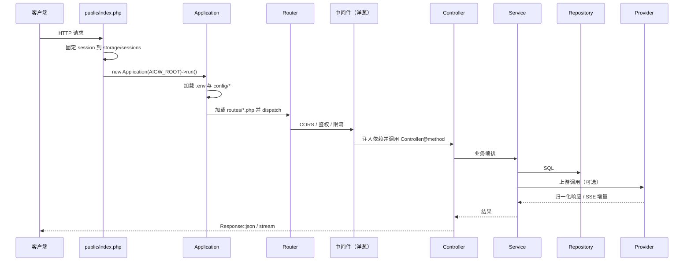

# 开发指南

> **文档导航**：[总目录](README.md) · [安装](installation.md) · [部署](deployment.md) · [配置](configuration.md) · [架构](architecture.md) · [API](api.md) · [供应商](providers.md) · [开发](development.md)

面向二次开发者：代码约定、目录职责、请求链路、**新增接口的完整模板**、供应商扩展、
数据库变更、调试与提交规范。先读 [架构说明](architecture.md) 效果更好。

---

## 目录

- [1. 开发环境准备](#1-开发环境准备)
- [2. 代码约定](#2-代码约定)
- [3. 目录职责](#3-目录职责)
- [4. 请求链路](#4-请求链路)
- [5. 新增一个接口的完整示例](#5-新增一个接口的完整示例)
- [6. 新增供应商适配器](#6-新增供应商适配器)
- [7. 数据库变更](#7-数据库变更)
- [8. 日志与调试](#8-日志与调试)
- [9. 错误处理与 SSE](#9-错误处理与-sse)
- [10. 前端控制台静态资源](#10-前端控制台静态资源)
- [11. 仓库不包含的内容](#11-仓库不包含的内容)
- [12. 提交前自检](#12-提交前自检)

---

## 1. 开发环境准备

推荐直接按 [安装指南 § 14](installation.md#14-本地开发环境windows-与-phpstudy) 在本地跑起来，然后：

```bash
# 打开调试（只看自己的机器！）
AIGW_APP_DEBUG=true

# 开发时建议关闭缓存类行为，改完刷新即生效
```

| 工具 | 建议 |
| --- | --- |
| 编辑器 | VS Code / PhpStorm，安装 PHP Intelephense |
| PHP 版本 | 与生产**完全一致**（8.2.x） |
| 代码检查 | `php -l` 逐文件语法检查（仓库不引入 Composer，因此没有 PHPStan/PHP-CS-Fixer） |
| 数据库工具 | phpMyAdmin / DBeaver，只连本地库 |

> [!NOTE]
> 本项目**没有**单元测试框架。仓库不含 `tests/`（详见 [§11](#11-仓库不包含的内容)），
> 所有回归验证靠**手工链路**：安装 → 登录 → 添加账号 → 对话 → 流式 → 管理台各页。

---

## 2. 代码约定

| 约定 | 说明 |
| --- | --- |
| `declare(strict_types=1)` | 所有 PHP 文件必须声明严格类型 |
| 命名空间 | `App\` 对应 `app/`，PSR-4 自动加载，**不使用 Composer** |
| 注释语言 | 中文；业务解释优先写「**为什么**」，不写「复述代码」 |
| 命名 | 类 `StudlyCase`、方法 `camelCase`、配置键 `snake_case`、表名 `aigw_*` |
| 数据库访问 | 只允许出现在 `app/Repositories`，控制器/服务不拼 SQL |
| 配置读取 | 一律经 `env()` / `config()`，禁止在业务代码里写死 |
| 敏感字段 | 输出到前端前必须 `mask_secret()` 脱敏 |
| 错误信息 | 面向用户的中文提示，不泄露 SQL、路径、堆栈 |
| 新增依赖 | 不引入 Composer 包；需要第三方能力时用原生扩展或内置 `HttpClient` |

---

## 3. 目录职责

```text
app/
├── Controllers/
│   ├── Admin/          管理端接口（/api/admin/*）
│   ├── User/           用户端接口（/api/user/*）
│   └── Gateway/        OpenAI 兼容接口（/v1/*）
├── Core/
│   ├── Application.php 启动、加载配置、dispatch
│   ├── Router.php      路由注册、匹配、SPA 兜底
│   ├── Container.php   反射自动装配的单例容器
│   ├── Config.php      .env → $_ENV，加载 config/*.php
│   ├── Database.php    PDO + 查询构造器 + 事务
│   └── Http/           Request / Response
├── Middleware/         CORS、AdminAuth、UserAuth、GatewayAuth、限流
├── Provider/           契约 Provider.php、AbstractProvider、ProviderManager、各上游实现
├── Repositories/       纯数据访问（SQL、表前缀常量）
├── Services/           业务编排（网关、账号池、Persona、MCP、工作流、调度 …）
└── Support/            工具（Logger、Crypto、HttpClient、Tenant、JsonSchema、UrlGuard …）
```

**分层原则**：

- Controller 只做「解析入参 → 调 Service → 返回 Response」，不写业务规则
- Service 编排多个 Repository 与 Provider，不直接 `new PDO`
- Repository 只做 SQL，不含业务判断
- Provider 只负责「上游协议」，不碰数据库与租户

---

## 4. 请求链路



容器按**构造函数类型提示**自动注入依赖；控制器方法里的 `Request` 参数会复用当前请求实例
（保留路由参数）。中间件是标准洋葱模型：`handle(Request $req, callable $next)`。

---

## 5. 新增一个接口的完整示例

以「用户端查询自己的调用统计」为例，五步走。

### 5.1 路由

```php
// routes/user.php
$router->get('/api/user/stats/summary', StatsController::class . '@summary', [
    UserAuthMiddleware::class,
]);
```

路由文件在启动时自动加载；路径支持 `{id}` 占位，参数会注入 `Request`。

### 5.2 仓储

```php
// app/Repositories/CallLogRepository.php
namespace App\Repositories;

use App\Core\Database;

final class CallLogRepository
{
    private const TABLE = 'aigw_call_log';

    /** 按租户统计最近 N 天的调用量 */
    public function countByTenant(int $userId, int $days = 7): int
    {
        $since = time() - $days * 86400;

        return (int) Database::instance()
            ->table(self::TABLE)
            ->where('user_id', $userId)
            ->where('created_at', '>=', $since)
            ->count();
    }
}
```

要点：表名放常量、只返回标量/数组、不在此层做权限判断。

### 5.3 服务

```php
// app/Services/StatsService.php
namespace App\Services;

use App\Repositories\CallLogRepository;

final class StatsService
{
    public function __construct(private CallLogRepository $logs) {}

    public function summary(int $userId): array
    {
        return [
            'calls_7d' => $this->logs->countByTenant($userId, 7),
        ];
    }
}
```

### 5.4 控制器

```php
// app/Controllers/User/StatsController.php
namespace App\Controllers\User;

use App\Core\Http\Request;
use App\Core\Http\Response;
use App\Services\StatsService;
use App\Support\Tenant;

final class StatsController
{
    public function __construct(private StatsService $stats) {}

    public function summary(Request $request): Response
    {
        $userId = (int) Tenant::userId();

        return Response::json(['data' => $this->stats->summary($userId)]);
    }
}
```

### 5.5 验证

```bash
# 语法检查
php -l app/Controllers/User/StatsController.php
php -l app/Services/StatsService.php
php -l app/Repositories/CallLogRepository.php

# 登录用户控制台后，浏览器打开
# GET /api/user/stats/summary
```

---

## 6. 新增供应商适配器

完整字段与登录方式见 [供应商适配](providers.md)。最短步骤：

1. 在 `app/Provider/Providers/` 新建类，继承 `AbstractProvider`，实现 `Provider` 契约
2. 在 `ProviderManager::$builtins` 注册 key（国际版可复用同一个类，通过 `withKey()` 区分区域）
3. 在 `database/schema.sql` 的供应商种子数据中补充记录与默认配置
4. 需要图标时，把素材放到 `public/assets/img/providers/` 并在前端供应商映射中登记

契约方法一览：

| 方法 | 职责 |
| --- | --- |
| `id()` / `displayName()` | 唯一 key 与展示名 |
| `loginType()` | `WEBVIEW_CALLBACK` / `OAUTH_LOOPBACK` / `DEVICE_CODE` / `SMS_CODE` / `API_KEY` |
| `hosts()` | 需要的上游域名（用于 SSRF 白名单与代理判定） |
| `supportsImageInput()` | 当前链路是否保留 `image_url` 内容块 |
| `chat()` | 请求体转换与上游调用（含 SSE 增量解析） |
| `models()` / `modelCatalog()` | 模型 ID 与模型目录（倍率、上下文、能力标签） |
| `credits()` | 额度 / 积分查询 |
| `action()` | 扩展动作：`checkin` / `tasks` / `redeem` |
| `refreshToken()` | 令牌刷新 |
| `startLogin()` / `pollLogin()` / `handleCallback()` / `ingestCredential()` | 登录流程 |
| `parseError()` | 上游错误 → 统一 `ErrorCategory` |

> [!TIP]
> 适配器只需要关心四件事：**登录换凭据、请求体转换、SSE 增量解析、错误归一化**。
> 账号池、冷却、限流、日志、计费口径全部由服务层统一处理，不要在适配器里重复实现。

---

## 7. 数据库变更

1. 修改 `database/schema.sql`（该文件用于**全新安装**，每张表前都有 `DROP TABLE IF EXISTS`）
2. **生产环境不要**用 `install.php --force` 升级 —— 那是清空整库，见
   [安装指南 § 6.2](installation.md#62-脚本做了什么)
3. 为线上准备**独立增量 SQL**，例如：

```sql
ALTER TABLE `aigw_call_log`
    ADD COLUMN `client_source` VARCHAR(32) NOT NULL DEFAULT '' AFTER `model`,
    ADD INDEX `idx_source` (`client_source`);
```

4. 仓储层老库兼容：已有表不会因 `CREATE TABLE` 自动加列，必要时在仓储内做「缺列补齐」
   （参考 `GatewayRepository::ADDED_COLUMNS` 的做法）

> [!WARNING]
> 改表结构时同步检查：`aigw_` 前缀常量、租户字段（`user_id`）、时间字段类型，
> 以及管理台相关页面的字段映射。漏改一处通常表现为「页面空白」而不是报错。

---

## 8. 日志与调试

```php
\App\Support\Logger::error('未捕获异常：' . $e->getMessage(), [
    'file' => $e->getFile() . ':' . $e->getLine(),
    'path' => $request->path(),
]);
```

| 日志 | 位置 | 内容 |
| --- | --- | --- |
| 应用日志 | `storage/logs/app-YYYY-MM-DD.log` | 业务关键节点、上游错误、修复记录 |
| PHP 错误 | `storage/logs/php-error.log` | 未捕获异常、Fatal、警告 |
| worker | `storage/logs/action-worker.log` 等 | 异步任务执行过程 |
| cron | `storage/logs/cron.log` | 计划任务输出 |

调试技巧：

- `AIGW_APP_DEBUG=true` 可把堆栈返回客户端，**只在本机使用**
- 请求体写入日志前必须脱敏（参考 `LogRepository`、`App\Support\Audit`）
- 流式问题优先看「是否被 Nginx/PHP 缓冲」，而不是加日志
- 上游报错先跑 `parseError()` 的归一化结果，确认是额度、鉴权还是模型不可用

---

## 9. 错误处理与 SSE

### 9.1 错误

- 可预期业务错误用 `App\Exceptions\*`，由控制器转换为统一 JSON
- 上游错误经 `Provider::parseError()` 归一化为 `ErrorCategory`
- 对外错误必须保持 OpenAI 风格：

```json
{"error":{"message":"...","type":"invalid_request_error","code":"invalid_api_key"}}
```

- 生产环境禁止把堆栈、SQL、文件路径返回客户端

### 9.2 SSE

流式接口必须：

- 关闭输出缓冲与压缩（`output_buffering=Off`、`zlib.output_compression=Off`、Nginx `fastcgi_buffering off`）
- 每帧以 `data: {...}\n\n` 结束
- 终态后发送 `data: [DONE]`
- 客户端断开时停止产出（`connection_aborted()` / 回调返回 `false`）

参考 `GatewayController` 中 chat completions 与 responses 的流式实现。

---

## 10. 前端控制台静态资源

控制台是 **Vue 3 global build 免构建 SPA**，没有 `npm install`，也没有打包步骤：

| 文件 | 作用 |
| --- | --- |
| `public/admin.html` / `public/index.html` / `public/home.html` | SPA 外壳 |
| `public/assets/js/app.js` / `app-admin.js` | 入口脚本 |
| `public/assets/js/pages*.js` | 分页逻辑（按功能拆分，避免单文件过大） |
| `public/assets/js/store.js` / `store-admin.js` | 状态管理 |
| `public/assets/js/api.js` | 统一请求封装 |
| `public/assets/css/app.css` | 样式 |
| `public/assets/vendor/vue.global.prod.js` | Vue 运行时（本地内置，不依赖 CDN） |

修改前端时：

1. 直接改 `public/assets/js/*.js`，刷新浏览器即可生效（`Cache-Control: no-cache`）
2. 新增页面时按现有 `pages-N.js` 的模块划分追加，避免所有逻辑集中到一个文件
3. 接口路径以 `api.js` 中的封装为准，不要在各个页面里散写 `fetch`
4. 任何展示敏感字段的地方都要走脱敏后的接口返回值

---

## 11. 仓库不包含的内容

本仓库**刻意不包含**原开发目录中的以下内容：

| 目录 / 文件 | 原因 |
| --- | --- |
| `tests/` | 接口与回归测试脚本（含真实域名、账号与请求样本） |
| `tools/` | 探针、诊断、实验脚本（含临时密钥与内部接口） |
| `mobile/` | Flutter 客户端（与后端仓库无关） |
| `storage/` 运行数据 | 会话、日志、缓存（可能含用户对话原文） |
| 数据库导出（`.sql` dump） | 含业务数据与账号信息 |
| `public/download/` | 客户端分发包（体积大） |
| `.env` | 数据库口令与凭据加密主密钥 |

> [!IMPORTANT]
> 如果你在本地需要这些内容，请放在**自己的私有目录或私有仓库**，
> 不要提交到本仓库。提交前务必执行 [§12](#12-提交前自检) 的检查。

---

## 12. 提交前自检

```bash
# 1) 语法检查（逐文件）
find app routes config bootstrap bin database -name '*.php' -print0 \
  | xargs -0 -n1 php -l

# 2) 确认没有把敏感文件加入暂存区
git status
git diff --cached --name-only | grep -E '\.env$|\.sql$|\.zip$|\.tar\.gz$|\.log$' || true

# 3) 搜索可疑凭据（按需调整关键词）
git diff --cached | grep -Ei 'sk-aigw-|sk-user-|GOCSPX|AKIA|BEGIN (RSA |EC )?PRIVATE KEY' || true
```

上线前再跑一遍手工链路：

- [ ] `GET /v1/health` 正常
- [ ] `/admin` 登录、刷新不掉线
- [ ] 添加一个账号并同步模型
- [ ] 非流式与流式对话都成功
- [ ] `/v1/models` 返回预期模型
- [ ] `storage/logs/` 无新增 `php-error.log` 记录
- [ ] 访问 `/storage/logs/app-*.log` 返回 404

---

## 相关文档

- [架构说明](architecture.md) —— 分层、数据模型、关键链路
- [供应商适配](providers.md) —— 上游契约与登录方式
- [API 参考](api.md) —— 对外接口契约
- [配置参考](configuration.md) —— 环境变量
- [安装指南](installation.md) —— 本地环境搭建
- [部署指南](deployment.md) —— 上线与运维
- [文档中心](README.md)
